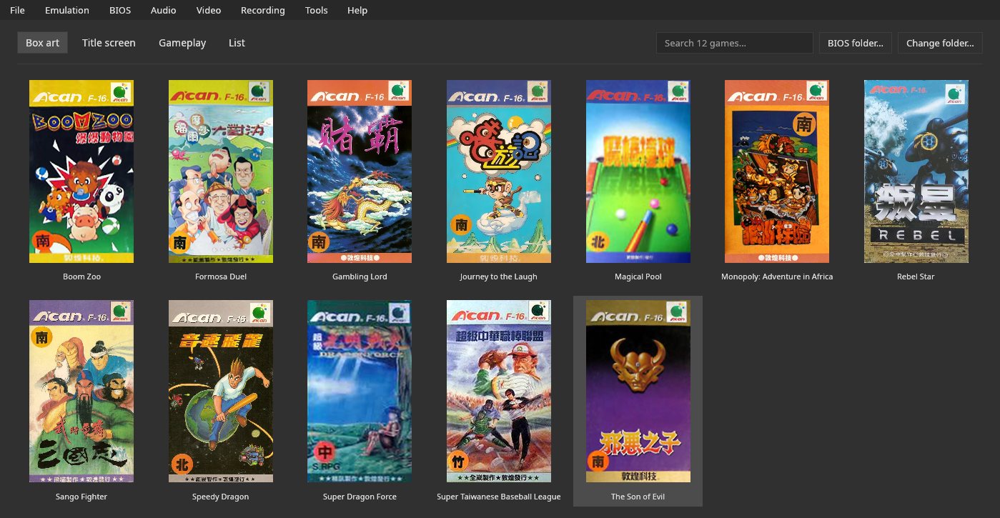

# V-Bear

[English](README.md) · [Português](README.pt-BR.md) · **Español**

**V-Bear** es un emulador de la **Funtech Super A'Can** (Taiwán, 1995) escrito en **Rust**.
Su comportamiento sigue el [núcleo de MiSTer](https://github.com/MiSTer-devel/SuperACan_MiSTer) y el driver `supracan`
de MAME, y fue comparado con ambos. Ejecuta los **12 juegos lanzados**, con una interfaz gráfica
completa:
- biblioteca con carátulas;
- save states y rewind;
- grabación de GIF y MP4;
- depurador y trucos.

También se distribuye como **núcleo libretro**, para RetroArch.

**Hecho con IA:** el código y esta documentación se escribieron con Claude Code (modelos
Claude Opus 5.5 y Claude Sonnet 5.5), con dirección, pruebas y revisión del autor.

**El nombre:** el oso negro de Formosa, de Taiwán, tiene una V blanca en el pecho. V-Bear es ese oso.



| | |
|---|---|
| Precisión | imagen **idéntica, píxel por píxel**, a la del núcleo de MiSTer simulado en 10 de los 12 juegos en el cuadro 300, sin ningún botón pulsado; RAM idéntica en 1 y con una diferencia de hasta 13 bytes en otros 6. El núcleo de MiSTer es, él mismo, una reconstrucción, y V-Bear **no** se ha comparado con una consola real ([precisión](docs/accuracy.es.md)) |
| Compatibilidad | los 12 juegos lanzados arrancan y se juegan; guardar y cargar comprobados a mano en 2 de los 6 juegos con batería ([lista](docs/compatibility.es.md)) |
| Velocidad | ~390 cuadros/s en un Ryzen 7 8700G (~6,5× el tiempo real), medido sin ventana (3.600 cuadros de Boom Zoo en 9,3 s) |
| Plataformas | Linux (Wayland y X11, AppImage) y Windows; FreeBSD (compilado por la pipeline de release, no probado); RetroArch en cualquier sistema que ejecute el núcleo |
| Licencia | GPL-3.0 o posterior ([`LICENSE`](LICENSE)) |

**La BIOS es obligatoria y no se incluye:** cuatro archivos de la consola, reconocidos por CRC32 con cualquier nombre
([Manual › BIOS](docs/manual.es.md#bios-obligatoria)).

## Descarga

Los binarios están en las [releases](https://github.com/PSGM-Romhacking/v-bear/releases):

| Archivo | Sistema |
|---|---|
| `v-bear-0.5.2-linux-x86_64.AppImage` | Linux x86-64 |
| `v-bear-0.5.2-windows-x86_64.exe` | Windows 10 y 11, 64 bits |
| `v-bear-0.5.2-freebsd-x86_64.tar.gz` | FreeBSD 14, x86-64 |
| `v_bear_libretro-0.5.2-linux-x86_64.zip`, `-windows-x86_64.zip`, `-freebsd-x86_64.zip` | el núcleo libretro y su `.info` |
| `SHA256SUMS` | sumas de verificación de todos los archivos |

En Linux: da `chmod +x` al AppImage y ejecútalo. Las notas de cada versión provienen del [`CHANGELOG.md`](CHANGELOG.md).
No hay versión para macOS.

## Controles predeterminados

| Acción | Teclado | Mando |
|---|---|---|
| Direcciones | flechas | cruceta y stick analógico izquierdo |
| B, A (jugador 1) | Z, X | los botones del mando, disposición del SNES |
| Y, X (jugador 1) | C, V | los botones del mando, disposición del SNES |
| Start, Select (jugador 1) | Enter, Tab | Start, Select |
| L, R | sin tecla predeterminada (se define en Controles) | L, R |
| Jugador 2 | W A S D; F G; H J; E; Q | el 2.º mando |
| Pausa / reinicio | P / F1 | — |
| Menú rápido (abrir y cerrar) | Esc (en modo sofá) | Home/Guide; Select + Start mantenidos medio segundo (opción) |
| Guardar / cargar estado; ranura −/+ | F2 / F4; F6 / F7 | — |
| Avance rápido / rewind (mantener) | Espacio / Retroceso | R2 / L2 |
| Sonido; volumen +/− | M; = / − | — |
| Pantalla completa; captura de pantalla; GIF; MP4 | F11; F12; F9; F10 | — |
| Abrir / cerrar juego / salir | Ctrl+O / Ctrl+W / Ctrl+Q | — |
| Actualizar la lista de juegos (vuelve a leer la carpeta de ROMs) | F5 | — |

Todo se puede reasignar en **Emulación › Controles y atajos…**.

## Compilación

```bash
cargo build --release -p v-bear
cargo build --release -p v-bear-libretro    # el núcleo libretro
```

Requisitos: Rust (cargo) y la biblioteca de audio ALSA (`libasound2-dev` y `pkg-config`
en Debian y Ubuntu, `alsa-lib-devel` en Fedora y openSUSE, `alsa-lib` en Arch).
Opcionales en tiempo de ejecución: `ffmpeg` (grabación de MP4), `curl` (descarga de carátulas) y
`xdg-open` (abrir carpetas). Sin ellos, solo esas funciones no están disponibles.
`make` compila el programa y lo copia a `./v-bear-<versión>-linux-<arquitectura>`;
`./packaging/build_linux.sh` y `./packaging/build_windows.sh` generan el AppImage y el `.exe`.

## Informar de un problema

Si V-Bear se cierra por un error, en el siguiente arranque muestra dónde se guardó el informe
(`~/.config/v-bear/crashes/`). Adjúntalo a la issue, con la versión y lo que estabas haciendo.
Consulta [Manual › Informar de un problema](docs/manual.es.md#informar-de-un-problema).

## Documentación

| Documento | Contenido |
|---|---|
| [Manual](docs/manual.es.md) | todas las funciones; la BIOS, partidas de batería, modo portátil, carpetas, carátulas propias, línea de comandos |
| [Compatibilidad](docs/compatibility.es.md) | los juegos probados, cómo, y el historial de cada ronda de pruebas |
| [Hardware](docs/hardware.es.md) | la Funtech Super A'Can en detalle y cómo la reproduce cada emulador |
| [Precisión y validación](docs/accuracy.es.md) | cómo se compara el emulador con el núcleo de MiSTer y MAME; qué falta |
| [Arquitectura](docs/architecture.es.md) | el código, cómo funciona la emulación y el razonamiento detrás de cada decisión |
| [Núcleo libretro](docs/libretro.es.md) | el núcleo para RetroArch |
| [Base de juegos](docs/sheets.es.md) | las fichas de información de los juegos: formato y reglas |
| [Traduciendo](docs/translating.es.md) | cómo traducir la interfaz a un nuevo idioma |
| [Lecciones aprendidas](docs/lessons.es.md) | lo que enseñó el proyecto |
| [Referencias](docs/references.es.md) | las fuentes citadas en los documentos |
| [Simulación de referencia](reference/README.es.md) | el núcleo de MiSTer simulado con Verilator: repite la comparación |
| [Changelog](CHANGELOG.md) | los cambios de cada versión |

## Licencias

| Parte | Licencia |
|---|---|
| V-Bear | GPL-3.0 o posterior ([`LICENSE`](LICENSE)) |
| Subconjunto de Noto Sans CJK JP | SIL Open Font License 1.1 |
| crates `m68k` (68000) y `mos6502` (65C02) | MIT y BSD-3-Clause |
| Comportamiento del hardware | sigue el [núcleo de MiSTer](https://github.com/MiSTer-devel/SuperACan_MiSTer) (GPL-2.0 o posterior) y el driver `supracan` de MAME (BSD-3-Clause); consulta [Referencias](docs/references.es.md) |
| Base de juegos | títulos, años y publicadoras de la lista de software de MAME (CC0); descripciones escritas para V-Bear |

Las ROMs y la BIOS no forman parte del proyecto.
