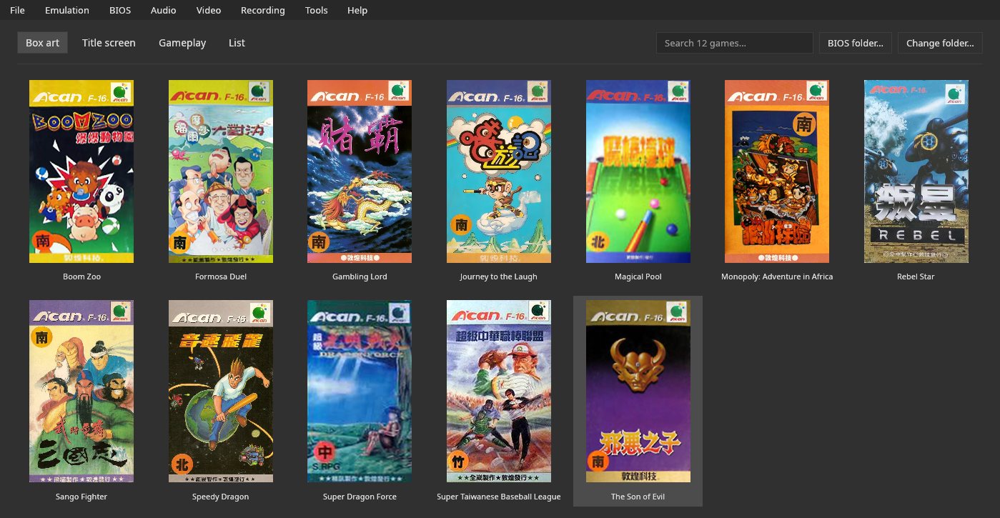

# V-Bear

**English** · [Português](README.pt-BR.md) · [Español](README.es.md)

**V-Bear** is an emulator of the **Funtech Super A'Can** (Taiwan, 1995) written in **Rust**.
Its behavior follows the [MiSTer core](https://github.com/MiSTer-devel/SuperACan_MiSTer) and MAME's `supracan`
driver, and it was compared with both. It runs the **12 released games**, with a complete graphical
interface:
- library with box art;
- save states and rewind;
- GIF and MP4 recording;
- debugger and cheats.

It also ships as a **libretro core**, for RetroArch.

**Made with AI:** the code and this documentation were written with Claude Code (models
Claude Opus 5.5 and Claude Sonnet 5.5), directed, tested and reviewed by the author.

**The name:** the Formosan black bear, from Taiwan, has a white V on its chest. V-Bear is that bear.



| | |
|---|---|
| Accuracy | picture **identical, pixel by pixel**, to the MiSTer core simulated in 10 of the 12 games at frame 300, with no button pressed; RAM identical in 1 and within 13 bytes in 6 more. The MiSTer core is itself a reconstruction, and V-Bear has **not** been compared with a real console ([accuracy](docs/accuracy.md)) |
| Compatibility | the 12 released games boot and play; saving and loading checked by hand in 2 of the 6 games with a battery ([list](docs/compatibility.md)) |
| Speed | ~390 frames/s on a Ryzen 7 8700G (~6.5× real time), measured with no window (3,600 frames of Boom Zoo in 9.3 s) |
| Platforms | Linux (Wayland and X11, AppImage) and Windows; FreeBSD (built by the release pipeline, not tested); RetroArch on any system that runs the core |
| License | GPL-3.0 or later ([`LICENSE`](LICENSE)) |

**The BIOS is required and is not included:** four files of the console, found by CRC32 under any name
([Manual › BIOS](docs/manual.md#bios-required)).

## Download

The binaries are in the [releases](https://github.com/PSGM-Romhacking/v-bear/releases):

| File | System |
|---|---|
| `v-bear-0.5.2-linux-x86_64.AppImage` | Linux x86-64 |
| `v-bear-0.5.2-windows-x86_64.exe` | Windows 10 and 11, 64-bit |
| `v-bear-0.5.2-freebsd-x86_64.tar.gz` | FreeBSD 14, x86-64 |
| `v_bear_libretro-0.5.2-linux-x86_64.zip`, `-windows-x86_64.zip`, `-freebsd-x86_64.zip` | the libretro core and its `.info` |
| `SHA256SUMS` | checksums of every file |

On Linux: `chmod +x` the AppImage and run it. Each version's notes come from [`CHANGELOG.md`](CHANGELOG.md).
There is no macOS version.

## Default controls

| Action | Keyboard | Controller |
|---|---|---|
| Directions | arrow keys | d-pad and left analog stick |
| B, A (player 1) | Z, X | the pad's buttons, SNES layout |
| Y, X (player 1) | C, V | the pad's buttons, SNES layout |
| Start, Select (player 1) | Enter, Tab | Start, Select |
| L, R | no default key (set in Controls) | L, R |
| Player 2 | W A S D; F G; H J; E; Q | the 2nd controller |
| Pause / reset | P / F1 | — |
| Quick menu (open and close) | Esc (in couch mode) | Home/Guide; Select + Start held for half a second (option) |
| Save / load state; slot −/+ | F2 / F4; F6 / F7 | — |
| Fast forward / rewind (hold) | Space / Backspace | R2 / L2 |
| Sound; volume +/− | M; = / − | — |
| Fullscreen; screenshot; GIF; MP4 | F11; F12; F9; F10 | — |
| Open / close game / quit | Ctrl+O / Ctrl+W / Ctrl+Q | — |
| Refresh game list (reads the ROM folder again) | F5 | — |

Everything can be remapped in **Emulation › Controls and shortcuts…**.

## Build

```bash
cargo build --release -p v-bear
cargo build --release -p v-bear-libretro    # the libretro core
```

Requirements: Rust (cargo) and the ALSA audio library (`libasound2-dev` and `pkg-config`
on Debian and Ubuntu, `alsa-lib-devel` on Fedora and openSUSE, `alsa-lib` on Arch).
Optional at runtime: `ffmpeg` (MP4 recording), `curl` (downloading box art) and
`xdg-open` (opening folders). Without them, only those features are unavailable.
`make` builds the program and copies it to `./v-bear-<version>-linux-<architecture>`;
`./packaging/build_linux.sh` and `./packaging/build_windows.sh` build the AppImage and the `.exe`.

## Reporting a problem

If V-Bear closes because of an error, the next start shows where the report was saved
(`~/.config/v-bear/crashes/`). Attach it to the issue, with the version and what you were doing.
See [Manual › Reporting a problem](docs/manual.md#reporting-a-problem).

## Documentation

| Document | Contents |
|---|---|
| [Manual](docs/manual.md) | every feature; the BIOS, battery saves, portable mode, folders, own box art, command line |
| [Compatibility](docs/compatibility.md) | the games tested, how, and the history of each round of tests |
| [Hardware](docs/hardware.md) | the Funtech Super A'Can in detail and how each emulator reproduces it |
| [Accuracy and validation](docs/accuracy.md) | how the emulator is compared with the MiSTer core and MAME; what is missing |
| [Architecture](docs/architecture.md) | the code, how the emulation works and the reasoning behind each decision |
| [libretro core](docs/libretro.md) | the core for RetroArch |
| [Game database](docs/sheets.md) | the games' info sheets: format and rules |
| [Translating](docs/translating.md) | how to translate the interface into a new language |
| [Lessons learned](docs/lessons.md) | what the project taught |
| [References](docs/references.md) | the sources cited in the documents |
| [Reference simulation](reference/README.md) | the MiSTer core simulated with Verilator: repeat the comparison |
| [Changelog](CHANGELOG.md) | the changes in each version |

## Licenses

| Part | License |
|---|---|
| V-Bear | GPL-3.0 or later ([`LICENSE`](LICENSE)) |
| Noto Sans CJK JP subset | SIL Open Font License 1.1 |
| `m68k` (68000) and `mos6502` (65C02) crates | MIT and BSD-3-Clause |
| Hardware behavior | follows the [MiSTer core](https://github.com/MiSTer-devel/SuperACan_MiSTer) (GPL-2.0 or later) and MAME's `supracan` driver (BSD-3-Clause); see [References](docs/references.md) |
| Game database | titles, years and publishers from MAME's software list (CC0); descriptions written for V-Bear |

The ROMs and the BIOS are not part of the project.
