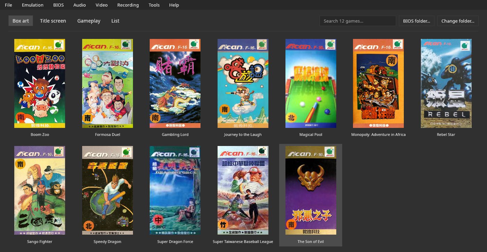

# V-Bear

[English](README.md) · **Português** · [Español](README.es.md)

O **V-Bear** é um emulador do **Funtech Super A'Can** (Taiwan, 1995) escrito em **Rust**.
Seu comportamento segue o [núcleo do MiSTer](https://github.com/MiSTer-devel/SuperACan_MiSTer) e o driver `supracan`
do MAME, e foi comparado com ambos. Ele roda os **12 jogos lançados**, com uma interface gráfica
completa:
- biblioteca com capas;
- save states e rewind;
- gravação de GIF e MP4;
- depurador e cheats.

Também é distribuído como **núcleo libretro**, para o RetroArch.

**Feito com IA:** o código e esta documentação foram escritos com o Claude Code (modelos
Claude Opus 5.5 e Claude Sonnet 5.5), com direção, testes e revisão do autor.

**O nome:** o urso-negro-de-Formosa, de Taiwan, tem um V branco no peito. O V-Bear é esse urso.



| | |
|---|---|
| Precisão | imagem **idêntica, pixel a pixel**, à do núcleo do MiSTer simulado em 10 dos 12 jogos no quadro 300, sem nenhum botão pressionado; RAM idêntica em 1 e com diferença de até 13 bytes em outros 6. O núcleo do MiSTer é, ele próprio, uma reconstrução, e o V-Bear **não** foi comparado com um console real ([precisão](docs/accuracy.md)) |
| Compatibilidade | os 12 jogos lançados iniciam e jogam; salvar e carregar verificados à mão em 2 dos 6 jogos com bateria ([lista](docs/compatibility.pt-BR.md)) |
| Velocidade | ~390 quadros/s em um Ryzen 7 8700G (~6,5× o tempo real), medido sem janela (3.600 quadros de Boom Zoo em 9,3 s) |
| Plataformas | Linux (Wayland e X11, AppImage) e Windows; FreeBSD (compilado pela pipeline de release, não testado); RetroArch em qualquer sistema que rode o núcleo |
| Licença | GPL-3.0 ou posterior ([`LICENSE`](LICENSE)) |

**A BIOS é obrigatória e não está incluída:** quatro arquivos do console, reconhecidos por CRC32 com qualquer nome
([Manual › BIOS](docs/manual.pt-BR.md#bios-obrigatória)).

## Download

Os binários estão nas [releases](https://github.com/PSGM-Romhacking/v-bear/releases):

| Arquivo | Sistema |
|---|---|
| `v-bear-0.5.2-linux-x86_64.AppImage` | Linux x86-64 |
| `v-bear-0.5.2-windows-x86_64.exe` | Windows 10 e 11, 64 bits |
| `v-bear-0.5.2-freebsd-x86_64.tar.gz` | FreeBSD 14, x86-64 |
| `v_bear_libretro-0.5.2-linux-x86_64.zip`, `-windows-x86_64.zip`, `-freebsd-x86_64.zip` | o núcleo libretro e seu `.info` |
| `SHA256SUMS` | somas de verificação de todos os arquivos |

No Linux: dê `chmod +x` no AppImage e execute. As notas de cada versão vêm do [`CHANGELOG.md`](CHANGELOG.md).
Não há versão para macOS.

## Controles padrão

| Ação | Teclado | Controle |
|---|---|---|
| Direções | setas | d-pad e analógico esquerdo |
| B, A (jogador 1) | Z, X | os botões do controle, layout do SNES |
| Y, X (jogador 1) | C, V | os botões do controle, layout do SNES |
| Start, Select (jogador 1) | Enter, Tab | Start, Select |
| L, R | sem tecla padrão (defina em Controles) | L, R |
| Jogador 2 | W A S D; F G; H J; E; Q | o 2º controle |
| Pausar / reiniciar | P / F1 | — |
| Menu rápido (abrir e fechar) | Esc (no modo sofá) | Home/Guide; Select + Start segurados por meio segundo (opção) |
| Salvar / carregar estado; slot −/+ | F2 / F4; F6 / F7 | — |
| Avanço rápido / rewind (segurar) | Espaço / Backspace | R2 / L2 |
| Som; volume +/− | M; = / − | — |
| Tela cheia; captura de tela; GIF; MP4 | F11; F12; F9; F10 | — |
| Abrir / fechar jogo / sair | Ctrl+O / Ctrl+W / Ctrl+Q | — |
| Atualizar a lista de jogos (lê a pasta de ROMs de novo) | F5 | — |

Tudo pode ser remapeado em **Emulação › Configurar controles e atalhos…**.

## Compilação

```bash
cargo build --release -p v-bear
cargo build --release -p v-bear-libretro    # o núcleo libretro
```

Requisitos: Rust (cargo) e a biblioteca de áudio ALSA (`libasound2-dev` e `pkg-config`
no Debian e Ubuntu, `alsa-lib-devel` no Fedora e openSUSE, `alsa-lib` no Arch).
Opcionais em tempo de execução: `ffmpeg` (gravação de MP4), `curl` (download de capas) e
`xdg-open` (abrir pastas). Sem eles, apenas esses recursos ficam indisponíveis.
O `make` compila o programa e o copia para `./v-bear-<versão>-linux-<arquitetura>`;
`./packaging/build_linux.sh` e `./packaging/build_windows.sh` geram o AppImage e o `.exe`.

## Relatando um problema

Se o V-Bear fechar por causa de um erro, na próxima inicialização ele mostra onde o relatório foi salvo
(`~/.config/v-bear/crashes/`). Anexe-o à issue, com a versão e o que você estava fazendo.
Veja [Manual › Relatando um problema](docs/manual.pt-BR.md#relatando-um-problema).

## Documentação

| Documento | Conteúdo |
|---|---|
| [Manual](docs/manual.pt-BR.md) | todos os recursos; a BIOS, saves de bateria, modo portátil, pastas, capas próprias, linha de comando |
| [Compatibilidade](docs/compatibility.pt-BR.md) | os jogos testados, como, e o histórico de cada rodada de testes |
| [Hardware](docs/hardware.pt-BR.md) | o Funtech Super A'Can em detalhe e como cada emulador o reproduz |
| [Precisão e validação](docs/accuracy.pt-BR.md) | como o emulador é comparado com o núcleo do MiSTer e o MAME; o que falta |
| [Arquitetura](docs/architecture.pt-BR.md) | o código, como a emulação funciona e o raciocínio por trás de cada decisão |
| [Núcleo libretro](docs/libretro.pt-BR.md) | o núcleo para o RetroArch |
| [Base de jogos](docs/sheets.pt-BR.md) | as fichas de informação dos jogos: formato e regras |
| [Traduzindo](docs/translating.pt-BR.md) | como traduzir a interface para um novo idioma |
| [Lições aprendidas](docs/lessons.pt-BR.md) | o que o projeto ensinou |
| [Referências](docs/references.pt-BR.md) | as fontes citadas nos documentos |
| [Simulação de referência](reference/README.pt-BR.md) | o núcleo do MiSTer simulado com o Verilator: repita a comparação |
| [Changelog](CHANGELOG.md) | as mudanças de cada versão |

## Licenças

| Parte | Licença |
|---|---|
| V-Bear | GPL-3.0 ou posterior ([`LICENSE`](LICENSE)) |
| Subconjunto da Noto Sans CJK JP | SIL Open Font License 1.1 |
| crates `m68k` (68000) e `mos6502` (65C02) | MIT e BSD-3-Clause |
| Comportamento do hardware | segue o [núcleo do MiSTer](https://github.com/MiSTer-devel/SuperACan_MiSTer) (GPL-2.0 ou posterior) e o driver `supracan` do MAME (BSD-3-Clause); veja [Referências](docs/references.pt-BR.md) |
| Base de jogos | títulos, anos e publicadoras da lista de software do MAME (CC0); descrições escritas para o V-Bear |

As ROMs e a BIOS não fazem parte do projeto.
