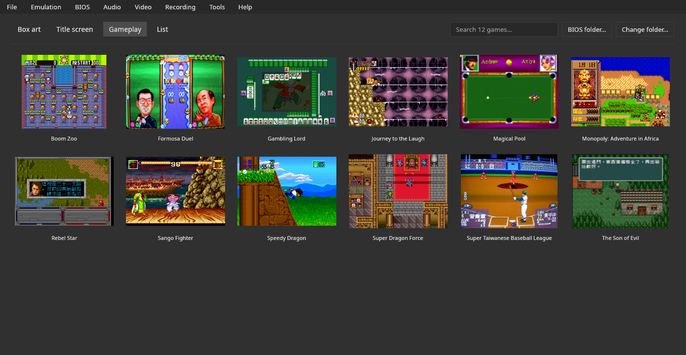
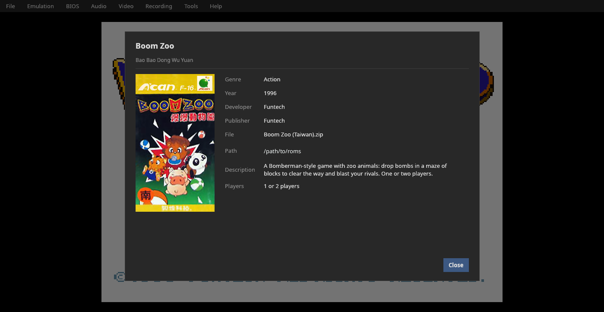
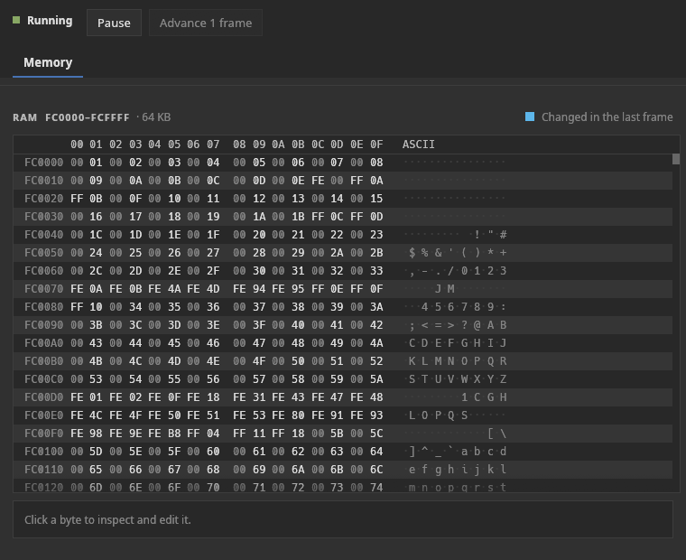
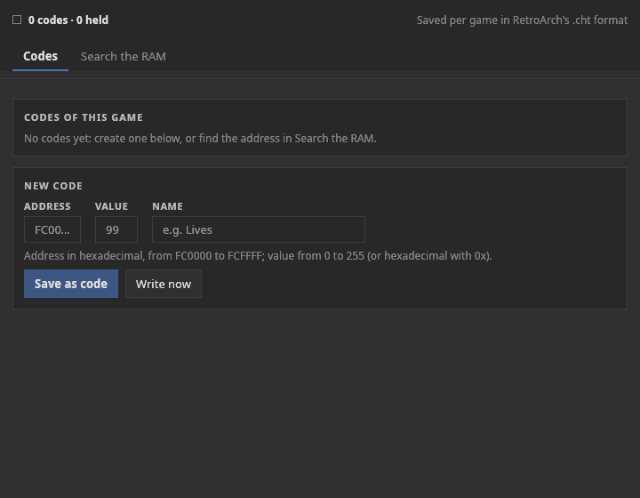

# Manual

[English](manual.md) · [Português](manual.pt-BR.md) · **Español**

Todo lo que hace el emulador y cómo usarlo. La descarga, la compilación y los controles por defecto están en
el [README](../README.es.md).

## Funciones del emulador

<!-- Screenshots: generate with the app itself (docs/kit-docs.md, "Screenshots"). -->
| | |
|---|---|
|  |  |
| Biblioteca: vista de pantalla de juego | Ficha del juego |
|  |  |
| Depurador: memoria | Trucos |

### Biblioteca

Es lo que muestra la ventana cuando no hay ningún juego abierto:
- cuadrícula con la **carátula** o con las imágenes de **pantalla de título / pantalla de juego**;
- búsqueda, cambio de carpeta y clic para abrir;
- **F5** (o **Archivo › Actualizar lista de juegos**) vuelve a leer la carpeta de ROMs, para juegos
  añadidos, quitados o renombrados con el emulador abierto;
- **primera ejecución:** cuando la carpeta no tiene juegos, una pantalla de bienvenida con el botón
  **Elegir la carpeta de ROMs…** (o la A del mando) y enlaces a **juegos gratuitos y legales**
  (`Brand.free_games`);
- clic derecho: **Abrir** y **Ficha del juego…**;
- los juegos se reconocen **por su contenido** (CRC32), así que el nombre del archivo no importa;
- las carátulas vienen de **libretro-thumbnails**, se descargan en segundo plano y se guardan en caché,
  buscadas por el nombre No-Intro de la ROM, como en RetroArch.

Formatos aceptados: `.bin` y `.can`, y esos mismos dentro de `.zip` o `.7z`. Un juego que viene en
dos archivos (Super Dragon Force, dos mask ROMs) se une automáticamente, el mayor primero. Los volcados se
aceptan en cualquier orden de bytes. Las cajas de la biblioteca son verticales, como las cajas de la Super A'Can
(proporción 0,66).

### Ficha del juego

Título, título original, año, editora, desarrolladora, código de producto, nombre del archivo y ruta completa,
y una descripción en el idioma actual, de la base de datos de juegos del proyecto
(`assets/games/`; formato en [`docs/sheets.md`](sheets.es.md)).
Los 12 juegos conocidos tienen ficha, en inglés, portugués y español. Las editoras vienen de la lista de software
de MAME y el número de jugadores de LaunchBox Games DB ([Referencias](references.es.md)).

### Jugando

| Función | Detalle |
|---|---|
| **Estados guardados** | 9 ranuras por juego, con miniatura del momento guardado y fecha/hora; el archivo guarda la huella de la ROM y rechaza un estado de otro juego |
| **Rebobinar** | un estado cada 2 cuadros, hasta ~30 s; mantén Backspace o L2; hasta 900 estados de ~267 KB cada uno, unos 240 MB de memoria |
| **Avance rápido** | mantener (Space / R2) o activar/desactivar; 2x, 3x, 4x u 8x |
| **Pausa** | P o Guide; se pausa sola al perder el foco (opcional) y con un menú o diálogo abierto |
| **Jugadores** | el 1.er mando es J1, el 2.º es J2…; el teclado tiene J1 y J2 (J2 en WASD); la consola tiene 2 puertos de mando |
| **Controles reasignables** | cada acción tiene una tecla y una entrada por mando, guardadas por nombre de driver |

### Vídeo

| Función | Detalle |
|---|---|
| Ventana 1x–6x | N píxeles de pantalla por píxel de juego, exacto incluso en Wayland |
| Escala entera | solo múltiplos enteros (píxeles uniformes) o llenando la ventana |
| Filtros | Ninguno, Scanlines, CRT |
| **Marcos** | rellenan los lados en pantalla completa: "Carátula del juego" (desenfocada y oscurecida); V-Bear no registra marcos (bezels) propios |
| Pantalla completa | F11; la barra de menús desaparece y vuelve cuando el ratón toca la parte superior |
| FPS y velocidad | indicador opcional |

### Sonido

El volumen por defecto es 30% (M silencia; `=` y `-` lo cambian). El chip de sonido de la consola emite a
44.744 Hz, y el emulador lo remuestrea a la frecuencia de la tarjeta de sonido. No hay silenciado por canal: el
núcleo no añade vistas de depuración propias.

### Grabación

| Función | Detalle |
|---|---|
| Captura de pantalla | F12: PNG en `~/Pictures/V-Bear/` |
| GIF | F9 |
| MP4 con sonido | F10: H.264 + AAC mediante `ffmpeg`, a la tasa de cuadros exacta (`Core::fps()`) |

Las grabaciones van a `~/Videos/V-Bear/` (las carpetas XDG de Imágenes y Vídeos; el nombre
localizado sigue al sistema). La codificación corre en un hilo aparte, y cerrar el programa en
medio de una grabación termina el archivo antes de salir.

### Herramientas

- **Depurador** (ventana aparte): RAM en vivo como editor hexadecimal, con los bytes que cambiaron en
  el último cuadro resaltados y un inspector con edición; el núcleo no añade
  vistas propias (`Core::debug_views()` está vacío).
  Estado de ejecución: en marcha / en pausa, pausa, avanzar 1 cuadro.
- **Trucos**, en dos pestañas:
  - **Códigos:** los códigos del juego (valor editable, valor actual en vivo, **Escribir ahora**,
    **Quitar** y **Fijar**, que bloquea el valor en cada cuadro) y el formulario **NUEVO CÓDIGO**;
  - **Buscar en la RAM:** empieza la búsqueda; juega hasta que el valor cambie y di qué
    pasó (Aumentó, Disminuyó, Cambió, No cambió, Es igual a), repitiendo hasta que queden
    pocas direcciones; **Usar** lleva la dirección elegida a la pestaña Códigos.
  - Valores en decimal o hexadecimal con `0x`. Se guardan por juego en el formato `.cht` de RetroArch,
    que también funciona en RetroArch con el core libretro.
- **Unir las partes del juego…** (solo en un sistema con juegos en más de un chip de ROM; en la Super A'Can,
  Super Dragon Force): guarda el juego como un solo archivo. Algunos juegos vienen en más de un archivo (por
  ejemplo, en un `.zip` o `.7z`) porque están en más de un chip del cartucho: Super Dragon Force tiene un chip
  de 2 MB y otro de 1 MB. V-Bear une las partes por sí solo al abrir el juego, así que esto **no es necesario
  para jugar**. Sirve para otros emuladores que esperan un solo archivo (el MiSTer, por ejemplo): primero va la
  parte de 2 MB y luego la de 1 MB, 3 MB en total, con CRC32 `c4fe1ca1`. La ventana muestra esta nota, el
  archivo del juego (el juego abierto, o **Elegir archivo…**) y **Guardar como…**; después muestra el tamaño,
  el CRC32 y si V-Bear reconoce el resultado. El archivo se llama `.can` por defecto y también se ofrece
  `.bin`: los dos nombres tienen exactamente los mismos bytes, y V-Bear abre ambos. **Conserva los archivos
  originales**: las bases de datos de juegos (No-Intro, MAME) listan cada parte con su propio checksum, así
  que las herramientas que identifican juegos por él, como el escáner de RetroArch, no reconocerán el archivo
  unido. Lo mismo por la línea de comandos, sin ventana: `v-bear --join "Super Dragon Force (Taiwan).7z"
  [salida.can] [--force]`; sin nombre de salida, escribe el nombre del juego con `.can` en la carpeta actual, y
  nunca sobrescribe un archivo sin `--force`.

### Mando y modo sofá

Para jugar desde el sofá, en una TV o en una portátil, sin teclado ni ratón:

- **Menú rápido, el "Esc" del mando:** se abre y se cierra en cualquier lugar con el
  botón **Home/Guide**, o **Select + Start mantenidos medio segundo** (para mandos
  sin Home; opcional), o **Esc** en modo sofá. Pausa el juego y ofrece:
  Continuar, Guardar estado, Cargar estado, Reiniciar, Volver a la biblioteca, **Modo sofá** y Salir.
- **Biblioteca con el mando:** la cruceta (o el stick izquierdo, o las flechas del teclado) mueve una
  selección entre las carátulas; el botón de abajo abre el juego; **Select pulsado solo**
  cambia la imagen (carátula, título, pantalla de juego).
- **Modo sofá** (**Vídeo › Modo sofá**): pantalla completa, sin barra de menús, carátulas
  más grandes y una línea de pistas de botones. Queda guardado hasta que se desactiva en el menú rápido.
- **El botón no "se cuela" en el juego:** mientras Select + Start se mantienen juntos, el
  juego no los recibe; y después de abrir un juego o cerrar el menú con el mando,
  la entrada del juego se ignora hasta que se suelten todos los botones.

### Interfaz

- Barra de menús al estilo de escritorio (Archivo, Emulación, Audio, Vídeo, Grabación, Herramientas, Ayuda).
- **Idiomas:** inglés (por defecto), portugués y español, cambiados en vivo; más idiomas
  solo necesitan un archivo JSON ([`docs/translating.md`](translating.es.md)).
- Se guardan las preferencias, la carpeta de ROMs, los juegos recientes, las teclas y los mandos.
- La ventana nunca se abre más grande que la pantalla (una escala grande en una pantalla pequeña se reduce para que quepa).
- Icono propio (`assets/icons/v-bear.svg`, un PNG de 256 px y un `.ico` para Windows). No hay entrada en
  el menú de aplicaciones: el `Makefile` solo instala el core libretro (`make install-libretro`).

## Instalación y uso

### Qué hace falta para ejecutarlo

Solo el ejecutable: icono, traducciones, base de datos de juegos, fuentes, tema y marcos están
incorporados. Al ejecutarse, crea:

| Carpeta | Contenido |
|---|---|
| `~/.config/v-bear/config.json` | preferencias, carpeta de ROMs, juegos recientes, teclas y mandos |
| `~/.config/v-bear/states/` | estados guardados y miniaturas |
| `~/.config/v-bear/bios/` | la BIOS (carpeta predeterminada; se puede cambiar) |
| `~/.config/v-bear/saves/` | guardados de batería (`<juego>.sav`) |
| `~/.config/v-bear/cheats/` | trucos (`.cht`) |
| `~/.config/v-bear/covers/` | tus propias carátulas (opcional) |
| `~/.config/v-bear/languages/` | tus propias traducciones (opcional) |
| `~/.config/v-bear/cache/covers/` | carátulas descargadas (se puede borrar a voluntad) |
| `~/.config/v-bear/usage.json` | tiempo de juego e historial de juego |
| `~/.config/v-bear/crashes/` | informes de error, solo si el programa llegó a cerrarse por un error |
| `~/Pictures/V-Bear/`, `~/Videos/V-Bear/` | capturas de pantalla y grabaciones |

Todo excepto las capturas de pantalla y las grabaciones está en **una carpeta**, así que una copia de seguridad o una sincronización
necesita solo `~/.config/v-bear/`. En Windows es `%APPDATA%\v-bear\`, con la misma estructura.

### BIOS (obligatoria)

La BIOS de la consola no se distribuye con V-Bear. Se necesitan cuatro archivos. Se reconocen por
su CRC32, con cualquier nombre de archivo, sueltos o dentro de un `.zip` o `.7z`:

| Archivo | Tamaño | CRC32 |
|---|---|---|
| `internal_68k.bin` | 4 KiB | `8d575662` |
| `internal_6502_1.bin` | 8 KiB | `fc9fb05f` |
| `internal_6502_2.bin` | 8 KiB | `bf950ab7` |
| `umc6650.bin` | 16 B | `0ba78597` |

Un único `supracan.zip` de MAME no tiene los cuatro: el más antiguo contiene `internal_68k.bin` y
`umc6650.bin`, el más nuevo `internal_68k.bin` y los dos archivos `internal_6502`. En las versiones
recientes de MAME el `umc6650.bin` viene en `umc6650.zip`, el conjunto propio del chip de lockout. El core de MiSTer pide los
mismos cuatro archivos (como `boot0.rom` a `boot3.rom`, o unidos en un solo `boot.rom`); la opción `--bios` del
modo sin ventana también acepta un `boot.rom`.

Ponlos en la carpeta de la **BIOS** (por defecto `~/.config/v-bear/bios/`) o en la carpeta de ROMs. La carpeta se puede
cambiar en varios lugares:

- el botón **Carpeta de la BIOS…** en la parte superior de la biblioteca, junto a "Cambiar carpeta…";
- el menú **BIOS**: elegir y abrir la carpeta, y la lista de los 4 archivos con tamaño, CRC32 y
  si cada uno fue encontrado (al hacer clic se copia el nombre y el CRC32; "Copiar lista" copia todo);
- **Emulación › Carpetas… › BIOS**;
- el aviso **FALTA LA BIOS** en la parte superior de la biblioteca, que nombra los archivos que faltan y desaparece cuando la
  BIOS está completa;
- el aviso al abrir un juego sin BIOS, que abre el juego en cuanto se elige la carpeta.

### Partida de batería

Super Taiwanese Baseball League guarda sus partidas en una SRAM de batería de 32 KB en el cartucho. V-Bear las escribe
en la carpeta **Partidas de batería** como `<juego>.sav`, unos segundos después de que cambien y al
cerrar el juego. El archivo es la SRAM de 32 KB. No se ha probado si un `.sav` de MiSTer o el `nvram` de MAME se acepta tal cual. De los 6 juegos con SRAM, guardar y cargar se confirmaron en dos (Super Taiwanese Baseball
League y The Son of Evil); véase [Compatibilidad](compatibility.es.md).

### Modo portátil

Crea un archivo vacío llamado **`portable.txt`** junto al ejecutable, y todo
(preferencias, partidas, trucos, carátulas, idiomas, capturas de pantalla y grabaciones) va a una
carpeta **`v-bear_data/`** junto a él en lugar de a tu carpeta de usuario. Las rutas dentro de la carpeta del
programa se guardan relativas a ella, así que la carpeta sigue funcionando en otro PC o en una memoria USB.
Si no se puede escribir en la carpeta, el emulador lo avisa al iniciar y usa la normal.

### Informar de un problema

Si el emulador se cierra por un error, escribe un informe en
`~/.config/v-bear/crashes/<fecha>.log` (versión, sistema, el juego que estaba abierto, el error y
dónde en el código ocurrió), y en el siguiente inicio muestra su ruta con un botón
**Abrir carpeta**. Adjunta ese archivo al informar del problema. Contiene la ruta del juego, que puede
incluir tu nombre de usuario.

### Carpetas, tus propias carátulas y nuevos idiomas

**Emulación › Carpetas…** lista todas las carpetas (ROMs, estados guardados, trucos, carátulas propias,
idiomas, capturas de pantalla, grabaciones), cada una con **Abrir**, **Cambiar…** y **Predeterminada**.

**Carátulas propias.** Pon PNG en la carpeta de carátulas con la estructura de libretro-thumbnails:
`Named_Boxarts/` (carátula), `Named_Titles/` (pantalla de título) y `Named_Snaps/` (pantalla de juego). El
nombre del archivo es el nombre No-Intro de la ROM. Tus imágenes tienen prioridad sobre las descargadas.

**Nuevos idiomas.** **Ayuda › Language / Idioma › Exportar plantilla de traducción…** guarda un archivo JSON
con todos los textos de la interfaz; traduce los valores, nombra el archivo con el código del
idioma (`fr.json`), ponlo en la carpeta de idiomas y reinicia. La guía completa, con
las reglas y **cómo enviar una traducción**, está en [`docs/translating.md`](translating.es.md).

### Línea de comandos

```bash
v-bear                       # abre la biblioteca
v-bear game.bin              # abre un juego (también .can, .zip, .7z)
v-bear /ruta/de/la/carpeta/      # abre la biblioteca en esa carpeta
v-bear game.bin --scale 4
v-bear --join juego.7z salida.can  # une las partes de un juego en un archivo (sin ventana)
```


Las demás opciones son `-s`/`--scale N` (escala de la ventana, de 1 a 6) y `-h`/`--help`. Para pruebas hay además
un modo sin ventana: `v-bear game.zip --frames 3600 [--bios PATH]` ejecuta esa cantidad de cuadros e imprime un
resumen (BIOS tomada de `bios/` o de `supracan.zip` junto al juego, en la carpeta actual o junto al
programa). Las variables de prueba (`V_BEAR_SHOT`, `V_BEAR_INPUT`, `V_BEAR_RAM`...) están en
[Compatibilidad](compatibility.es.md).
