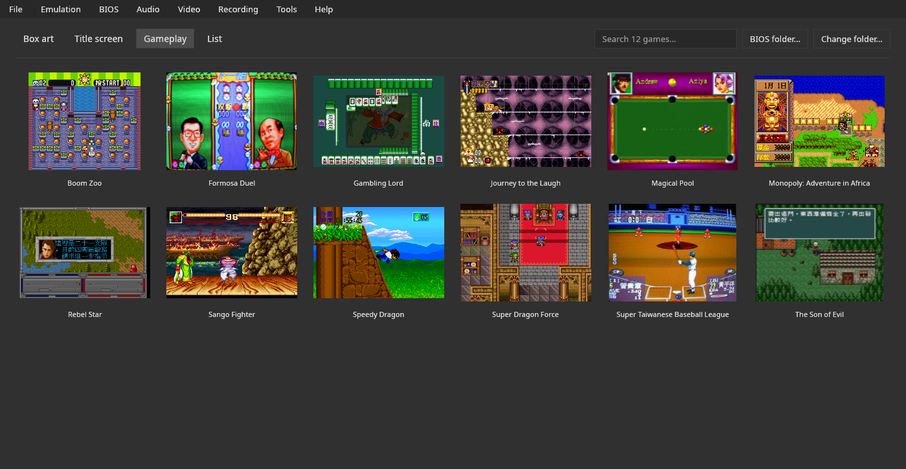
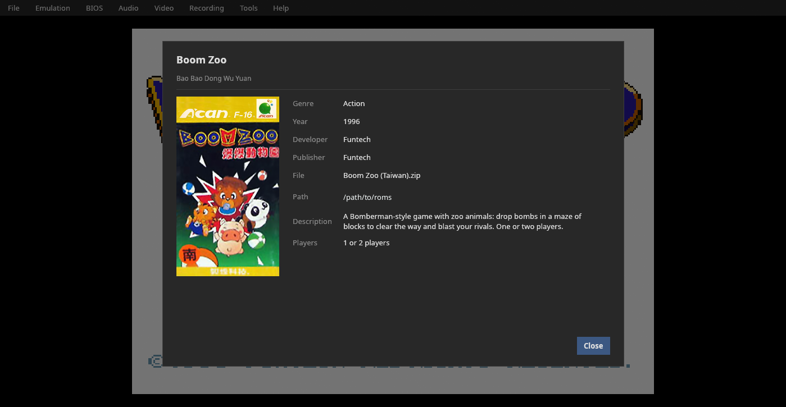
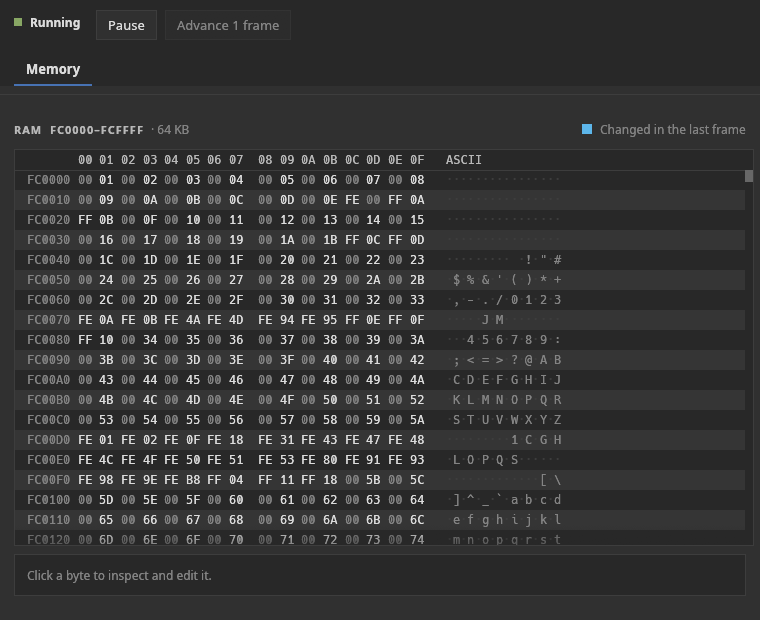
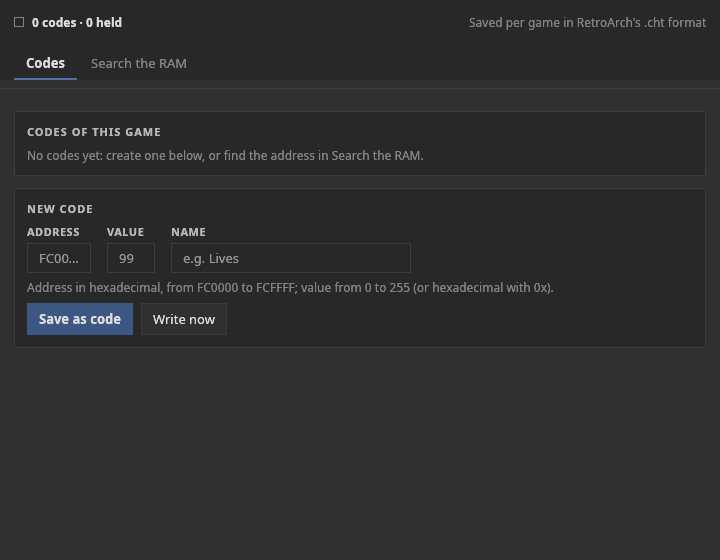

# Manual

**English** · [Português](manual.pt-BR.md) · [Español](manual.es.md)

Everything the emulator does and how to use it. Download, build and default controls are in
the [README](../README.md).

## Emulator features

<!-- Screenshots: generate with the app itself (docs/kit-docs.md, "Screenshots"). -->
| | |
|---|---|
|  |  |
| Library: gameplay view | Game info sheet |
|  |  |
| Debugger: memory | Cheats |

### Library

It is what the window shows when no game is open:
- grid with the **box art** or with the **title screen / gameplay** images;
- search, change folder, and click to open;
- **F5** (or **File › Refresh game list**) reads the ROM folder again, for games added,
  removed or renamed with the emulator open;
- **first run:** when the folder has no games, a welcome screen with the **Choose the ROM
  folder…** button (or the controller's A) and links to **free, legal games**
  (`Brand.free_games`);
- right-click: **Open** and **Game info…**;
- games are recognized **by content** (CRC32), so the file name does not matter;
- box art comes from **libretro-thumbnails**, downloaded in the background and cached,
  looked up by the ROM's No-Intro name, as in RetroArch.

Accepted formats: `.bin` and `.can`, and those same ones inside `.zip` or `.7z`. A game that comes in
two files (Super Dragon Force, two mask ROMs) is joined automatically, the larger one first. Dumps are
accepted in either byte order. The boxes in the library are portrait, as the Super A'Can's boxes
(aspect 0.66).

### Game info

Title, original title, year, publisher, developer, product code, file name and full path,
and a description in the current language, from the project's game database
(`assets/games/`; format in [`docs/sheets.md`](sheets.md)).
All 12 known games have a sheet, in English, Portuguese and Spanish. Publishers come from MAME's
software list and the number of players from the LaunchBox Games DB ([References](references.md)).

### Playing

| Feature | Detail |
|---|---|
| **Save states** | 9 slots per game, with a thumbnail of the saved moment and date/time; the file stores the ROM's fingerprint and rejects a state from another game |
| **Rewind** | one state every 2 frames, up to ~30 s; hold Backspace or L2; up to 900 states of ~267 KB each, about 240 MB of memory |
| **Fast forward** | hold (Space / R2) or toggle on and off; 2x, 3x, 4x or 8x |
| **Pause** | P or Guide; pauses by itself when unfocused (optional) and with a menu or dialog open |
| **Players** | the 1st controller is P1, the 2nd is P2…; the keyboard has P1 and P2 (P2 on WASD); the console has 2 pad ports |
| **Remappable controls** | each action has a key and one input per controller, saved by driver name |

### Video

| Feature | Detail |
|---|---|
| Window 1x–6x | N screen pixels per game pixel, exact even on Wayland |
| Integer scaling | integer multiples only (uniform pixels) or filling the window |
| Filters | None, Scanlines, CRT |
| **Frames** | fill the sides in fullscreen: "Game cover" (blurred and darkened); V-Bear registers no bezels of its own |
| Fullscreen | F11; the menu bar disappears and comes back when the mouse touches the top |
| FPS and speed | optional indicator |

### Sound

The default volume is 30% (M mutes; `=` and `-` change it). The console's sound chip outputs at
44,744 Hz, and the emulator resamples it to the sound card's rate. There is no per-channel mute: the
core adds no debugger views of its own.

### Recording

| Feature | Detail |
|---|---|
| Screenshot | F12: PNG in `~/Pictures/V-Bear/` |
| GIF | F9 |
| MP4 with sound | F10: H.264 + AAC via `ffmpeg`, at the exact frame rate (`Core::fps()`) |

Recordings go to `~/Videos/V-Bear/` (the XDG Pictures and Videos folders; the localized
name follows the system). Encoding runs in a separate thread, and closing the program in
the middle of a recording finishes the file before exiting.

### Tools

- **Debugger** (separate window): live RAM as a hex editor, with the bytes that changed in
  the last frame highlighted and an inspector with editing; the core adds no
  views of its own (`Core::debug_views()` is empty).
  Run state: running / paused, pause, advance 1 frame.
- **Cheats**, in two tabs:
  - **Codes:** the game's codes (editable value, live current value, **Write now**,
    **Remove** and **Hold**, which locks the value every frame) and the **new code** form;
  - **Search the RAM:** start the search; play until the value changes and say what
    happened (Increased, Decreased, Changed, Did not change, Is equal to), repeating until
    few addresses are left; **Use** takes the chosen address to the Codes tab.
  - Values in decimal or hexadecimal with `0x`. Saved per game in RetroArch's `.cht`
    format, which also works in RetroArch with the libretro core.
- **Join game parts…** (only in a system with games on more than one ROM chip; for the Super A'Can, Super
  Dragon Force): saves the game as a single file. Some games come in more than one file (for example, in a
  `.zip` or a `.7z`) because they are on more than one chip in the cartridge: Super Dragon Force has a 2 MB
  chip and a 1 MB one. V-Bear joins the parts by itself when it opens the game, so this is **not needed to
  play**. It is for other emulators that expect one file (the MiSTer, for example): the 2 MB part goes first,
  then the 1 MB one, 3 MB in all, with CRC32 `c4fe1ca1`. The window shows this note, the game's file (the open
  game, or **Choose file…**) and **Save as…**; afterwards it shows the size, the CRC32 and whether V-Bear
  recognizes the result. The file is named `.can` by default and `.bin` is offered too: the two names hold
  exactly the same bytes, and V-Bear opens both. **Keep the original files**: the game databases (No-Intro,
  MAME) list each part with its own checksum, so tools that identify games by it, like RetroArch's scanner,
  will not recognize the joined file. The same from the command line, with no window:
  `v-bear --join "Super Dragon Force (Taiwan).7z" [output.can] [--force]`; without an output name it writes the
  game's name with `.can` in the current folder, and it never overwrites a file unless `--force` is given.

### Controller and couch mode

To play from the couch, on a TV or a handheld, with no keyboard or mouse:

- **Quick menu, the controller's "Esc":** opens and closes anywhere with the
  **Home/Guide** button, or **Select + Start held for half a second** (for controllers
  without Home; optional), or **Esc** in couch mode. It pauses the game and offers:
  Continue, Save state, Load state, Reset, Back to the library, **Couch mode** and Quit.
- **Library by controller:** the d-pad (or the left stick, or the arrow keys) moves a
  selection between the covers; the bottom button opens the game; **Select tapped alone**
  changes the image (cover, title, gameplay).
- **Couch mode** (**Video › Couch mode**): fullscreen, no menu bar, bigger
  covers and a line of button hints. It stays saved until it is turned off in the quick menu.
- **The button doesn't "leak" into the game:** while Select + Start are held together, the
  game doesn't get them; and after opening a game or closing the menu with the controller,
  game input is ignored until every button is released.

### Interface

- Desktop-style menu bar (File, Emulation, Audio, Video, Recording, Tools, Help).
- **Languages:** English (default), Portuguese and Spanish, switched live; more languages
  need only a JSON file ([`docs/translating.md`](translating.md)).
- Preferences, ROM folder, recent games, keys and controllers are saved.
- The window never opens bigger than the screen (a large scale on a small screen is shrunk to fit).
- Its own icon (`assets/icons/v-bear.svg`, a 256 px PNG and an `.ico` for Windows). There is no entry in
  the applications menu: the `Makefile` only installs the libretro core (`make install-libretro`).

## Installation and usage

### What it takes to run

Just the executable: icon, translations, game database, fonts, theme and frames are
embedded. When run, it creates:

| Folder | Contents |
|---|---|
| `~/.config/v-bear/config.json` | preferences, ROM folder, recent games, keys and controllers |
| `~/.config/v-bear/states/` | save states and thumbnails |
| `~/.config/v-bear/bios/` | the BIOS (default folder; it can be changed) |
| `~/.config/v-bear/saves/` | battery saves (`<game>.sav`) |
| `~/.config/v-bear/cheats/` | cheats (`.cht`) |
| `~/.config/v-bear/covers/` | your own box art (optional) |
| `~/.config/v-bear/languages/` | your own translations (optional) |
| `~/.config/v-bear/cache/covers/` | downloaded box art (can be deleted at will) |
| `~/.config/v-bear/usage.json` | play time and play history |
| `~/.config/v-bear/crashes/` | error reports, only if the program ever closed because of an error |
| `~/Pictures/V-Bear/`, `~/Videos/V-Bear/` | screenshots and recordings |

Everything except screenshots and recordings is in **one folder**, so a backup or a sync
needs only `~/.config/v-bear/`. On Windows it is `%APPDATA%\v-bear\`, with the same layout.

### BIOS (required)

The console's BIOS is not distributed with V-Bear. Four files are needed. They are recognized by
their CRC32, with any file name, loose or inside a `.zip` or `.7z`:

| File | Size | CRC32 |
|---|---|---|
| `internal_68k.bin` | 4 KiB | `8d575662` |
| `internal_6502_1.bin` | 8 KiB | `fc9fb05f` |
| `internal_6502_2.bin` | 8 KiB | `bf950ab7` |
| `umc6650.bin` | 16 B | `0ba78597` |

A single MAME `supracan.zip` does not have all four: the older one holds `internal_68k.bin` and
`umc6650.bin`, the newer one `internal_68k.bin` and the two `internal_6502` files. In recent MAME
versions `umc6650.bin` comes in `umc6650.zip`, the lockout chip's own set. The MiSTer core asks for the
same four files (as `boot0.rom` to `boot3.rom`, or joined in one `boot.rom`); the `--bios` option of the
windowless mode also accepts a `boot.rom`.

Put them in the **BIOS** folder (default `~/.config/v-bear/bios/`) or in the ROM folder. The folder can be
changed in several places:

- the **BIOS folder…** button at the top of the library, next to "Change folder…";
- the **BIOS** menu: choose and open the folder, and the list of the 4 files with size, CRC32 and
  whether each was found (clicking copies the name and CRC32; "Copy list" copies everything);
- **Emulation › Folders… › BIOS**;
- the **BIOS MISSING** notice at the top of the library, which names the missing files and disappears when the
  BIOS is complete;
- the notice when opening a game without BIOS, which opens the game as soon as the folder is chosen.

### Battery save

Super Taiwanese Baseball League keeps its saves in a 32 KB battery SRAM in the cartridge. V-Bear writes
them to the **Battery saves** folder as `<game>.sav`, a few seconds after they change and when the
game is closed. The file is the SRAM's 32 KB. Whether a MiSTer `.sav` or MAME's `nvram` is accepted as it is has not been
tested. Of the 6 games with SRAM, saving and loading were confirmed in two (Super Taiwanese Baseball
League and The Son of Evil); see [Compatibility](compatibility.md).

### Portable mode

Create an empty file named **`portable.txt`** next to the executable, and everything
(preferences, saves, cheats, box art, languages, screenshots and recordings) goes into a
**`v-bear_data/`** folder next to it instead of your user folder. Paths inside the program's
folder are saved relative to it, so the folder keeps working on another PC or a USB stick.
If the folder can't be written to, the emulator says so at startup and uses the normal one.

### Reporting a problem

If the emulator closes because of an error, it writes a report to
`~/.config/v-bear/crashes/<date>.log` (version, system, the game that was open, the error and
where in the code it happened), and the next start shows its path with an **Open folder**
button. Attach that file when reporting the problem. It contains the game's path, which may
include your user name.

### Folders, your own box art and new languages

**Emulation › Folders…** lists every folder (ROMs, save states, cheats, own box art,
languages, screenshots, recordings), each with **Open**, **Change…** and **Default**.

**Own box art.** Put PNGs in the box art folder with the libretro-thumbnails layout:
`Named_Boxarts/` (cover), `Named_Titles/` (title screen) and `Named_Snaps/` (gameplay). The
file name is the ROM's No-Intro name. Your images win over the downloaded ones.

**New languages.** **Help › Language / Idioma › Export translation template…** saves a JSON
file with every text of the interface; translate the values, name the file after the
language code (`fr.json`), put it in the languages folder and restart. The full guide, with
the rules and **how to send a translation**, is in [`docs/translating.md`](translating.md).

### Command line

```bash
v-bear                       # opens the library
v-bear game.bin              # opens a game (also .can, .zip, .7z)
v-bear /path/to/folder/      # opens the library in that folder
v-bear game.bin --scale 4
v-bear --join game.7z out.can    # joins a game's parts into one file (no window)
```


The other options are `-s`/`--scale N` (window scale, 1 to 6) and `-h`/`--help`. For testing there is also
a mode with no window: `v-bear game.zip --frames 3600 [--bios PATH]` runs that many frames and prints a
summary (BIOS taken from `bios/` or `supracan.zip` next to the game, in the current folder or next to
the program). The test variables (`V_BEAR_SHOT`, `V_BEAR_INPUT`, `V_BEAR_RAM`...) are in
[Compatibility](compatibility.md#how-to-test).
