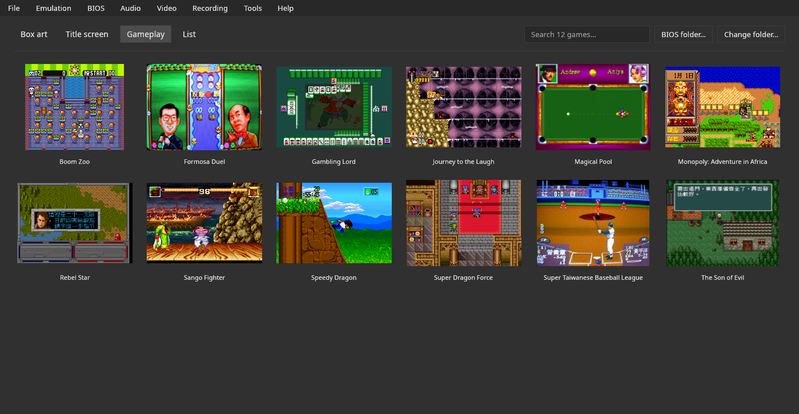
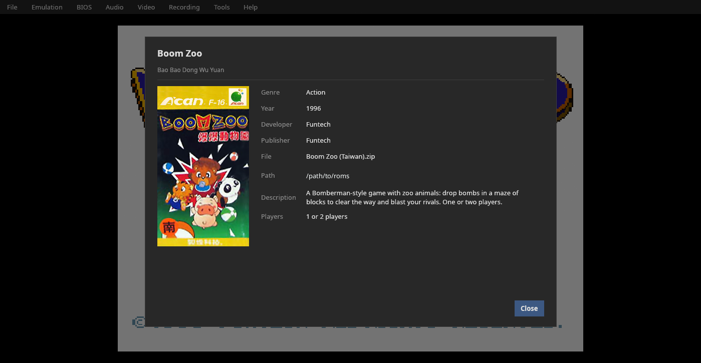
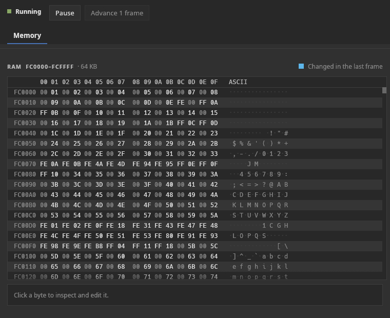
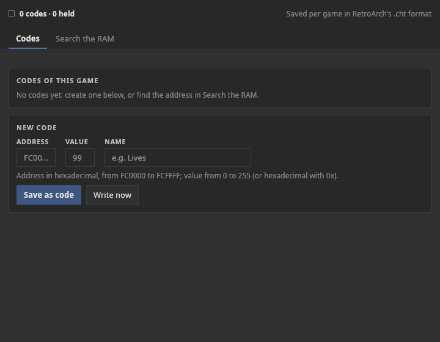

# Manual

[English](manual.md) · **Português** · [Español](manual.es.md)

Tudo o que o emulador faz e como usá-lo. Download, compilação e controles padrão estão no
[README](../README.pt-BR.md).

## Recursos do emulador

<!-- Screenshots: generate with the app itself (docs/kit-docs.md, "Screenshots"). -->
| | |
|---|---|
|  |  |
| Biblioteca: vista de tela de jogo | Ficha do jogo |
|  |  |
| Depurador: memória | Trapaças |

### Biblioteca

É o que a janela mostra quando nenhum jogo está aberto:
- grade com a **capa** ou com as imagens de **tela de título / tela de jogo**;
- busca, troca de pasta e clique para abrir;
- **F5** (ou **Arquivo › Atualizar lista de jogos**) lê a pasta de ROMs de novo, para jogos
  adicionados, removidos ou renomeados com o emulador aberto;
- **primeira execução:** quando a pasta não tem jogos, uma tela de boas-vindas com o botão
  **Escolher a pasta de ROMs…** (ou o A do controle) e links para **jogos gratuitos e legais**
  (`Brand.free_games`);
- botão direito: **Abrir** e **Ficha do jogo…**;
- os jogos são reconhecidos **pelo conteúdo** (CRC32), então o nome do arquivo não importa;
- as capas vêm do **libretro-thumbnails**, baixadas em segundo plano e guardadas em cache,
  buscadas pelo nome No-Intro da ROM, como no RetroArch.

Formatos aceitos: `.bin` e `.can`, e esses mesmos dentro de `.zip` ou `.7z`. Um jogo que vem em
dois arquivos (Super Dragon Force, duas mask ROMs) é juntado automaticamente, o maior primeiro. Os dumps são
aceitos em qualquer ordem de bytes. As caixas na biblioteca são em retrato, como as caixas do Super A'Can
(proporção 0,66).

### Ficha do jogo

Título, título original, ano, editora, desenvolvedora, código do produto, nome do arquivo e caminho completo,
e uma descrição no idioma atual, do banco de dados de jogos do projeto
(`assets/games/`; formato em [`docs/sheets.md`](sheets.pt-BR.md)).
Os 12 jogos conhecidos têm ficha, em inglês, português e espanhol. As editoras vêm da lista de software
do MAME e o número de jogadores do LaunchBox Games DB ([Referências](references.pt-BR.md)).

### Jogando

| Recurso | Detalhe |
|---|---|
| **Save states** | 9 slots por jogo, com miniatura do momento salvo e data/hora; o arquivo guarda a impressão digital da ROM e rejeita um estado de outro jogo |
| **Retroceder** | um estado a cada 2 quadros, até ~30 s; segure Backspace ou L2; até 900 estados de ~267 KB cada, cerca de 240 MB de memória |
| **Avançar rápido** | segurar (Space / R2) ou liga/desliga; 2x, 3x, 4x ou 8x |
| **Pausar** | P ou Guide; pausa sozinho ao perder o foco (opcional) e com um menu ou diálogo aberto |
| **Jogadores** | o 1º controle é o J1, o 2º é o J2…; o teclado tem J1 e J2 (J2 no WASD); o console tem 2 portas de controle |
| **Controles configuráveis** | cada ação tem uma tecla e uma entrada por controle, salvas pelo nome do driver |

### Vídeo

| Recurso | Detalhe |
|---|---|
| Janela 1x–6x | N pixels de tela por pixel de jogo, exato até no Wayland |
| Escala inteira | só múltiplos inteiros (pixels uniformes) ou preenchendo a janela |
| Filtros | Nenhum, Scanlines, CRT |
| **Molduras** | preenchem as laterais em tela cheia: "Capa do jogo" (desfocada e escurecida); o V-Bear não registra molduras (bezels) próprias |
| Tela cheia | F11; a barra de menus some e volta quando o mouse toca o topo |
| FPS e velocidade | indicador opcional |

### Som

O volume padrão é 30% (M silencia; `=` e `-` mudam o volume). O chip de som do console emite a
44.744 Hz, e o emulador o reamostra para a taxa da placa de som. Não há silenciamento por canal: o
núcleo não acrescenta visões de depuração próprias.

### Gravação

| Recurso | Detalhe |
|---|---|
| Captura de tela | F12: PNG em `~/Pictures/V-Bear/` |
| GIF | F9 |
| MP4 com som | F10: H.264 + AAC via `ffmpeg`, na taxa de quadros exata (`Core::fps()`) |

As gravações vão para `~/Videos/V-Bear/` (as pastas XDG de Imagens e Vídeos; o nome
localizado segue o sistema). A codificação roda numa thread separada, e fechar o programa no
meio de uma gravação termina o arquivo antes de sair.

### Ferramentas

- **Depurador** (janela separada): RAM ao vivo como editor hexadecimal, com os bytes que mudaram no
  último quadro destacados e um inspetor com edição; o núcleo não acrescenta
  visões próprias (`Core::debug_views()` é vazio).
  Estado de execução: rodando / pausado, pausar, avançar 1 quadro.
- **Trapaças**, em duas abas:
  - **Códigos:** os códigos do jogo (valor editável, valor atual ao vivo, **Gravar agora**,
    **Remover** e **Fixar**, que trava o valor a cada quadro) e o formulário **NOVO CÓDIGO**;
  - **Buscar na RAM:** comece a busca; jogue até o valor mudar e diga o que
    aconteceu (Aumentou, Diminuiu, Mudou, Não mudou, É igual a), repetindo até sobrarem
    poucos endereços; **Usar** leva o endereço escolhido para a aba Códigos.
  - Valores em decimal ou hexadecimal com `0x`. Salvos por jogo no formato `.cht` do RetroArch,
    que também funciona no RetroArch com o core libretro.
- **Juntar partes do jogo…** (só num sistema com jogos em mais de um chip de ROM; no Super A'Can, o Super
  Dragon Force): salva o jogo como um arquivo único. Alguns jogos vêm em mais de um arquivo (por exemplo,
  num `.zip` ou `.7z`) porque estão em mais de um chip no cartucho: o Super Dragon Force tem um chip de 2 MB e
  outro de 1 MB. O V-Bear junta as partes sozinho ao abrir o jogo, então isto **não é necessário para jogar**.
  Serve para outros emuladores que esperam um arquivo só (o MiSTer, por exemplo): a parte de 2 MB vai primeiro e
  depois a de 1 MB, 3 MB no total, com CRC32 `c4fe1ca1`. A janela mostra esta nota, o arquivo do jogo (o jogo
  aberto, ou **Escolher arquivo…**) e **Salvar como…**; depois mostra o tamanho, o CRC32 e se o V-Bear
  reconhece o resultado. O arquivo se chama `.can` por padrão e o `.bin` também é oferecido: os dois nomes têm
  exatamente os mesmos bytes, e o V-Bear abre os dois. **Guarde os arquivos originais**: os bancos de dados
  de jogos (No-Intro, MAME) listam cada parte com seu próprio checksum, então as ferramentas que identificam
  jogos por ele, como o scanner do RetroArch, não reconhecerão o arquivo unido. O mesmo pela linha de comando,
  sem janela: `v-bear --join "Super Dragon Force (Taiwan).7z" [saida.can] [--force]`; sem nome de saída, grava o
  nome do jogo com `.can` na pasta atual, e nunca sobrescreve um arquivo sem `--force`.

### Controle e modo sofá

Para jogar do sofá, numa TV ou num portátil, sem teclado nem mouse:

- **Menu rápido, o "Esc" do controle:** abre e fecha em qualquer lugar com o
  botão **Home/Guide**, ou **Select + Start segurados por meio segundo** (para controles
  sem Home; opcional), ou **Esc** no modo sofá. Pausa o jogo e oferece:
  Continuar, Salvar estado, Carregar estado, Reiniciar, Voltar à biblioteca, **Modo sofá** e Sair.
- **Biblioteca pelo controle:** o direcional (ou o analógico esquerdo, ou as setas do teclado) move uma
  seleção entre as capas; o botão de baixo abre o jogo; **Select tocado sozinho**
  troca a imagem (capa, título, tela de jogo).
- **Modo sofá** (**Vídeo › Modo sofá**): tela cheia, sem barra de menus, capas
  maiores e uma linha de dicas de botões. Fica salvo até ser desligado no menu rápido.
- **O botão não "vaza" para o jogo:** enquanto Select + Start estão segurados juntos, o
  jogo não os recebe; e depois de abrir um jogo ou fechar o menu com o controle,
  a entrada do jogo é ignorada até todos os botões serem soltos.

### Interface

- Barra de menus ao estilo desktop (Arquivo, Emulação, Áudio, Vídeo, Gravação, Ferramentas, Ajuda).
- **Idiomas:** inglês (padrão), português e espanhol, trocados ao vivo; mais idiomas
  precisam só de um arquivo JSON ([`docs/translating.md`](translating.pt-BR.md)).
- Preferências, pasta de ROMs, jogos recentes, teclas e controles são salvos.
- A janela nunca abre maior que a tela (uma escala grande numa tela pequena é reduzida para caber).
- Ícone próprio (`assets/icons/v-bear.svg`, um PNG de 256 px e um `.ico` para Windows). Não há entrada no
  menu de aplicativos: o `Makefile` só instala o core libretro (`make install-libretro`).

## Instalação e uso

### O que é preciso para rodar

Só o executável: ícone, traduções, banco de dados de jogos, fontes, tema e molduras estão
embutidos. Ao rodar, ele cria:

| Pasta | Conteúdo |
|---|---|
| `~/.config/v-bear/config.json` | preferências, pasta de ROMs, jogos recentes, teclas e controles |
| `~/.config/v-bear/states/` | save states e miniaturas |
| `~/.config/v-bear/bios/` | a BIOS (pasta padrão; pode ser trocada) |
| `~/.config/v-bear/saves/` | saves de bateria (`<jogo>.sav`) |
| `~/.config/v-bear/cheats/` | trapaças (`.cht`) |
| `~/.config/v-bear/covers/` | suas próprias capas (opcional) |
| `~/.config/v-bear/languages/` | suas próprias traduções (opcional) |
| `~/.config/v-bear/cache/covers/` | capas baixadas (pode ser apagada à vontade) |
| `~/.config/v-bear/usage.json` | tempo de jogo e histórico de jogo |
| `~/.config/v-bear/crashes/` | relatórios de erro, só se o programa já fechou por causa de um erro |
| `~/Pictures/V-Bear/`, `~/Videos/V-Bear/` | capturas de tela e gravações |

Tudo, exceto capturas de tela e gravações, fica em **uma pasta**, então um backup ou uma sincronização
precisa só de `~/.config/v-bear/`. No Windows é `%APPDATA%\v-bear\`, com a mesma estrutura.

### BIOS (obrigatória)

A BIOS do console não é distribuída com o V-Bear. São necessários quatro arquivos. Eles são reconhecidos pelo
CRC32, com qualquer nome de arquivo, soltos ou dentro de um `.zip` ou `.7z`:

| Arquivo | Tamanho | CRC32 |
|---|---|---|
| `internal_68k.bin` | 4 KiB | `8d575662` |
| `internal_6502_1.bin` | 8 KiB | `fc9fb05f` |
| `internal_6502_2.bin` | 8 KiB | `bf950ab7` |
| `umc6650.bin` | 16 B | `0ba78597` |

Um único `supracan.zip` do MAME não tem os quatro: o mais antigo contém `internal_68k.bin` e
`umc6650.bin`, o mais novo `internal_68k.bin` e os dois arquivos `internal_6502`. Nas versões
recentes do MAME o `umc6650.bin` vem no `umc6650.zip`, o conjunto próprio do chip de lockout. O core do MiSTer pede os
mesmos quatro arquivos (como `boot0.rom` a `boot3.rom`, ou juntos num só `boot.rom`); a opção `--bios` do
modo sem janela também aceita um `boot.rom`.

Coloque-os na pasta da **BIOS** (padrão `~/.config/v-bear/bios/`) ou na pasta de ROMs. A pasta pode ser
mudada em vários lugares:

- o botão **Pasta da BIOS…** no topo da biblioteca, ao lado de "Trocar pasta…";
- o menu **BIOS**: escolher e abrir a pasta, e a lista dos 4 arquivos com tamanho, CRC32 e
  se cada um foi encontrado (clicar copia o nome e o CRC32; "Copiar lista" copia tudo);
- **Emulação › Pastas… › BIOS**;
- o aviso **BIOS FALTANDO** no topo da biblioteca, que cita os arquivos que faltam e some quando a
  BIOS está completa;
- o aviso ao abrir um jogo sem BIOS, que abre o jogo assim que a pasta é escolhida.

### Save de bateria

O Super Taiwanese Baseball League guarda seus saves numa SRAM de bateria de 32 KB no cartucho. O V-Bear os grava
na pasta **Saves de bateria** como `<jogo>.sav`, alguns segundos depois de mudarem e quando o
jogo é fechado. O arquivo é a SRAM de 32 KB. Não foi testado se um `.sav` do MiSTer ou o `nvram` do MAME é aceito como está. Dos 6 jogos com SRAM, salvar e carregar foram confirmados em dois (Super Taiwanese Baseball
League e The Son of Evil); veja [Compatibilidade](compatibility.pt-BR.md).

### Modo portátil

Crie um arquivo vazio chamado **`portable.txt`** ao lado do executável, e tudo
(preferências, saves, trapaças, capas, idiomas, capturas de tela e gravações) vai para uma
pasta **`v-bear_data/`** ao lado dele, em vez da sua pasta de usuário. Os caminhos dentro da pasta do
programa são salvos relativos a ela, então a pasta continua funcionando em outro PC ou num pen drive.
Se a pasta não puder ser gravada, o emulador avisa ao iniciar e usa a normal.

### Relatando um problema

Se o emulador fechar por causa de um erro, ele grava um relatório em
`~/.config/v-bear/crashes/<data>.log` (versão, sistema, o jogo que estava aberto, o erro e
onde no código aconteceu), e na próxima inicialização mostra o caminho dele com um botão
**Abrir pasta**. Anexe esse arquivo ao relatar o problema. Ele contém o caminho do jogo, que pode
incluir seu nome de usuário.

### Pastas, suas próprias capas e novos idiomas

**Emulação › Pastas…** lista todas as pastas (ROMs, save states, trapaças, capas próprias,
idiomas, capturas de tela, gravações), cada uma com **Abrir**, **Alterar…** e **Padrão**.

**Capas próprias.** Coloque PNGs na pasta de capas com a estrutura do libretro-thumbnails:
`Named_Boxarts/` (capa), `Named_Titles/` (tela de título) e `Named_Snaps/` (tela de jogo). O
nome do arquivo é o nome No-Intro da ROM. Suas imagens têm prioridade sobre as baixadas.

**Novos idiomas.** **Ajuda › Language / Idioma › Exportar modelo de tradução…** salva um arquivo JSON
com todos os textos da interface; traduza os valores, dê ao arquivo o nome do código do
idioma (`fr.json`), coloque-o na pasta de idiomas e reinicie. O guia completo, com
as regras e **como enviar uma tradução**, está em [`docs/translating.md`](translating.pt-BR.md).

### Linha de comando

```bash
v-bear                       # abre a biblioteca
v-bear game.bin              # abre um jogo (também .can, .zip, .7z)
v-bear /caminho/da/pasta/      # abre a biblioteca nessa pasta
v-bear game.bin --scale 4
v-bear --join jogo.7z saida.can  # junta as partes de um jogo em um arquivo (sem janela)
```


As outras opções são `-s`/`--scale N` (escala da janela, 1 a 6) e `-h`/`--help`. Para testes há também
um modo sem janela: `v-bear game.zip --frames 3600 [--bios PATH]` roda essa quantidade de quadros e imprime um
resumo (BIOS tirada de `bios/` ou de `supracan.zip` ao lado do jogo, na pasta atual ou ao lado do
programa). As variáveis de teste (`V_BEAR_SHOT`, `V_BEAR_INPUT`, `V_BEAR_RAM`...) estão em
[Compatibilidade](compatibility.pt-BR.md).
